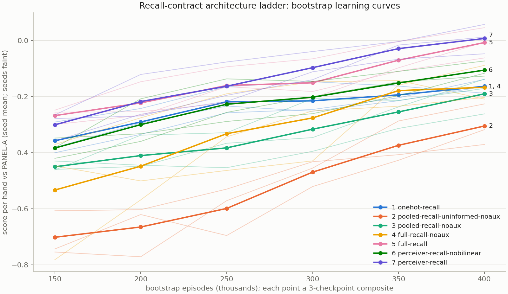
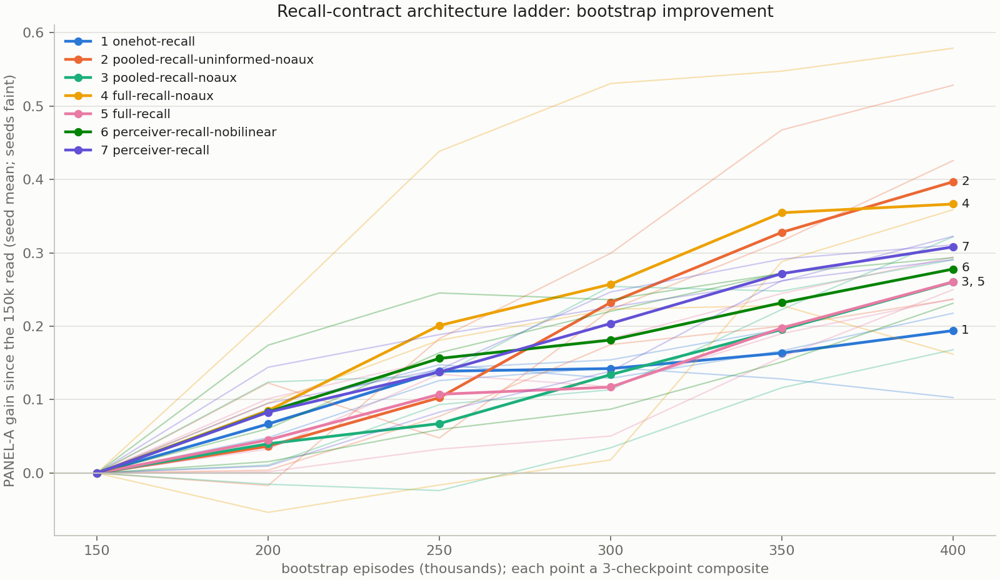

# Architecture Ablation — Recall-Contract Ladder (October 2026)

Successor to `Architecture_Ablation_202607.md` (the July study), built for
the write-up: a clean, additive architecture ladder trained through the
**202609_recall_rc bootstrap phase exactly as the release trained it**,
from a one-hot MLP baseline to the released `perceiver-recall`.

**Question:** under the release's observation contract (no blind/bury
re-injection; Training_Program_Redesign_202609 §3.2) and its bootstrap
recipe, what does each major architectural addition buy in shaped
self-play learning — speed, 400k-episode skill, and convention learning?

---

# 1. Current state

| item | value |
|---|---|
| status | **COMPLETE** — launched 2026-10-28, finished 2026-11-02 07:23; all 21 cells, 0 failed reads (§4, §5 log) |
| driver | `python -m sheepshead.training.run_recall_ablation {train,eval,status}` |
| run code | detached worktree `/Volumes/Nargothrond/dev/sheepsheadai-ablation-202610` (own `.venv`; `runs/`, `models/` symlinked to the main checkout) at the commit in §5 |
| outputs | `runs/arch_ablation_202610/<arch>_s<seed>/` (checkpoints, `train.log`, `status.json`, `eval/`); driver log `runs/arch_ablation_202610/driver.log` |
| results | `notebooks/arch_ablation_202610.csv`, `notebooks/arch_ablation_202610_deltas.csv`, `notebooks/figures/arch_ablation_202610_panelA.png` — rebuilt by `python -m sheepshead.research.recall_ablation_report` (safe to run any time; unfinished cells are blank) |
| progress | `uv run python -m sheepshead.training.run_recall_ablation status` |

Order of work: all training (one run at a time, seed-major: the full
seed-42 ladder, then 1042, then 2042), then every evaluation read
(8 single-threaded processes), then the report. Both stages are
resumable — rerunning `train` skips finished cells and resumes an
interrupted cell from its newest checkpoint (recorded as a second
segment in its `status.json`, `resumed: true` in the CSV); rerunning
`eval` skips existing outputs.

---

# 2. Design

## 2.1 The ladder

Seven rungs; each adds one component to the rung below it (except
5→6, see §2.3). All rungs read exactly `observation.RECALL_KEYS` and
carry a recurrent memory (the only route by which the picker's blind and
bury reach later decisions).

| rung | arch | adds | informed init | aux heads | bilinear pointer | params |
|---|---|---|---|---|---|---|
| 1 | `onehot-recall` | baseline: flat one-hot → MLP + GRU memory, flat per-phase heads | — | — | — | 1,093,487 |
| 2 | `pooled-recall-uninformed-noaux` | card tokens + per-bag attention pools + pointer actor | — | — | — | 837,390 |
| 3 | `pooled-recall-noaux` | + informed card-embedding init | ✓ | — | — | 837,390 |
| 4 | `full-recall-noaux` | + transformer card reasoning (4 layers × 4 heads) | ✓ | — | — | 823,822 |
| 5 | `full-recall` | + aux critic heads (= the production 30M design under the recall observation) | ✓ | ✓ | — | 935,895 |
| 6 | `perceiver-recall-nobilinear` | + shared 16-query readout + memory-token memory driver | ✓ | ✓ | — | 1,099,863 |
| 7 | `perceiver-recall` | + bilinear state × card play pointer (**the release**) | ✓ | ✓ | ✓ | 1,120,343 |

Lineage: rungs 2–5 are the July ladder (`no-transformer-uninformed` →
`no-transformer` → `no-aux` → `full`) under the recall observation; rung
1 is `onehot-ff` minus the blind/bury one-hot sections (434 → 366
inputs). Registry entries: `sheepshead/agent/architectures/registry.py`
("Recall-contract ladder").

## 2.2 Recipe (identical for every cell)

The release's phase-0 command (`runs/202609_recall_rc/orchestrator.log`,
2026-09-16) plus the arch, seed and an explicit aux scale:

```bash
python -m sheepshead.training.train_ppo --phase bootstrap --arch <ARCH> \
    --run-name arch_ablation_202610/<ARCH>_s<SEED> --until 400000 \
    --save-interval 50000 --greedy-eval-interval 50000 --greedy-eval-games 200 \
    --num-workers 8 --seed <SEED> --aux-det-scale 1.0
```

Shaped reward, limited critic, all heads trainable, γ 0.99,
`BootstrapHyperparams` (4096-transition updates, 4 epochs × 256, the
self-play entropy schedule over 400k), leaster watchdog ON (default),
no worker device/compile flags (as the release). Seeds 42, 1042, 2042
(the July convention).

**Aux coefficients at 1.0×.** `04cd382` (09-28) baked 2.5× coefficients
for the four deterministic aux heads into `PPOAgent`; the release
bootstrap (09-16) predates the scale option (introduced 09-18) and
trained at 1.0×. `train_ppo --aux-det-scale` (default 2.5, unchanged
behavior elsewhere) restores the original values for this study.

**The release's bootstrap IS cell (perceiver-recall, 42).** Same recipe,
same seed, aux 1.0×; audited 2026-10-28: every commit touching the
bootstrap training path after 09-16 is either the aux change, the
bidding phase, the league entropy controller, the policy-iteration
corpus, import/exception refactors, or the opt-in deploy sampler. It is
read, not retrained (`run_recall_ablation.REUSED`).

## 2.3 Known confounds (state them in the write-up)

1. **Rung 5→6 changes two things** (shared readout replacing the bag
   pools, and the memory driver moving from the context token to the
   memory token) and adds ~164k parameters (the 16-query readout). The
   single-switch decomposition arm `shared-recall` (v2 readout, context
   driver) was dropped by operator choice (July: v2 ≈ full); it can be
   added later at ≈1.3 days for 3 seeds without disturbing anything here.
2. **Order dependence.** Ladder deltas are conditional on the rungs below.
   July measured informed init at +0.060 without the transformer vs
   +0.150 with it (screening grade); here it enters at rung 3, before
   the transformer, so its delta is expected to be the smaller one.
3. **Rung 1→2 bundles the pointer actor with card tokens** (the pointer
   scores cards by their tokens; there is nothing to point at in a
   one-hot vector).
4. **Parameter counts differ** (0.82M–1.12M). Not param-matched; the
   counts are reported alongside.
5. **Regime.** Shaped self-play bootstrap only — July's P3 rule made this
   regime screening-grade for adoption decisions; here no adoption rides
   on it, the bootstrap phase is the object of study.

## 2.4 Decision log

| date | decision | by |
|---|---|---|
| 10-28 | New ablation on the bootstrap phase, recall observation, release hyperparameters; MLP baseline and release as endpoints | operator |
| 10-28 | Bilinear pointer gets its own step (operator: it made optimal conventions much faster to learn) | operator |
| 10-28 | Additive ladder only (no leave-one-out arms); aux and informed init enter as ladder steps; `shared-recall` dropped | operator |
| 10-28 | Order follows the July ladder (informed init before transformer) | proposed, accepted with the ladder |
| 10-28 | Aux coefficients 1.0× (directly comparable to the release bootstrap); 3 seeds | operator |
| 10-28 | Release bootstrap reused as (perceiver-recall, 42) | follows from 1.0× |
| 10-28 | Training sequential at equal load; evaluation batched afterwards (8 procs) so wall-clock / eps/s are comparable across cells | implementation |
| 10-28 | Run from a detached worktree with its own venv (branch switches / `uv sync` in the main checkout cannot reach the live run) | implementation |

---

# 3. Instruments and pre-registered reads

## 3.1 Instruments

| instrument | spec | stages | per read |
|---|---|---|---|
| **PANEL-A** (headline) | `league_progress_eval.eval_endpoint`, panel `PANEL-A` by manifest key (30M, pfsp 15M, pfsp 5M, selfplay 100k), 3,996 CRN deals (seed 42), both modes, three-checkpoint composite (N−100k, N−50k, N) | 150k…400k every 50k (6 reads/cell) | ~40 min single-thread |
| **PANEL-B** | same, panel `PANEL-B` (30M, v2 release, iter-11 P1, v2 league 8M) | 400k | ~40 min |
| **Convention battery** | the program's `greedy_health_probe` × 4 seeds × 1,000 greedy self-play games (pick/alone/leaster rates, t0 trump lead, partner trump lead, called-suit lead, logit spread, aux-head reads where present) | every checkpoint, 50k…400k | ~4 min |
| run-level | wall-clock (sequential, equal load), eps/s, watchdog engage/release episodes (from `train.log`), parameter count | per cell | free |

PANEL identity changed with the model-artifacts work (10-27): reads are
by manifest key with design hashes PANEL-A `3e6443e4c5e9`, PANEL-B
`04046aaca26e`. The release's recorded bootstrap reads
(`panel_reference.csv`, old hashes) are **not** pairable and are
re-read here like every other cell.

## 3.2 Reads (pre-registered 2026-10-28, before any new cell trained)

- **Endpoint** = the 400k composite (checkpoints 300k/350k/400k) — the
  release's protocol, and July rule 1 (last three checkpoints).
- **Rung delta** = paired per-deal difference between rung k and rung
  k−1 on the same seed (same CRN deals), averaged over seeds; seed-level
  SE from the three per-seed deltas. Reported for every PANEL-A stage
  and the PANEL-B endpoint (`arch_ablation_202610_deltas.csv`).
- **Calling a delta real** (descriptive; no adoption decision rides on
  this study): |seed-mean delta| > 2 seed-level SE **and** all three
  seeds agree in sign. Anything else is reported as unresolved with its
  interval — not as "no effect".
- **Learning speed** is read off the PANEL-A curve (150k→400k) and the
  watchdog escape episodes; no slope claims from the in-trainer
  greedy-health rows (July rule 2).
- **Bilinear hypothesis** (operator, pre-registered): rung 6→7 shows up
  most clearly in the convention battery — partner trump lead and
  called-suit lead rates rising earlier/faster in rung 7 — possibly
  more than in the panel delta (panels dilute rare-situation skill,
  July §5.11 validity limits).

## 3.3 Throughput and budget (smoke 2026-10-28; 600 episodes, 8 workers)

| arch | eps/s (smoke) | est. 400k |
|---|---|---|
| onehot-recall | 36.7 | ~3.0 h |
| pooled-recall-* | 25.1–25.7 | ~4.4 h each |
| full-recall-noaux / full-recall | 12.6–12.7 | ~8.8 h each |
| perceiver-recall-nobilinear | 12.9 | ~8.6 h |
| perceiver-recall | (release, measured) 14.3 | 7.77 h |

≈ 46 h of training per seed → ≈ 129 h (≈ 5.4 days) for 20 new cells;
evaluation ≈ 147 panel reads + 168 convention reads on 8 processes
≈ 14–16 h. **Expected completion ≈ 2026-11-03/04.** The seed-42 ladder
completes first (≈ 1.6 days in).

---

# 4. Results

All 21 cells trained in a single segment each (no resumes); every
PANEL-A, PANEL-B and convention read landed. Source of every number
below: `notebooks/arch_ablation_202610.csv` and `_deltas.csv`.

## 4.1 Endpoint table (400k composite; mean over seeds ± seed SE)

Δ = paired per-deal delta vs the rung below, seed mean ± seed-level SE.
**Bold** = real under the §3.2 rule (|Δ| > 2 SE and 3/3 seeds agree in
sign); otherwise unresolved, with the count of seeds above zero.

| rung | arch | PANEL-A | PANEL-B | Δ A vs rung below | Δ B vs rung below | wall h | eps/s | watchdog release ep (per seed) |
|---|---|---|---|---|---|---|---|---|
| 1 | `onehot-recall` | −0.164 ± 0.014 | −0.505 ± 0.022 | — | — | 2.59 | 42.8 | 5.8k; never engaged on s1042, s2042 |
| 2 | `pooled-recall-uninformed-noaux` | −0.305 ± 0.042 | −0.639 ± 0.038 | **−0.142 ± 0.028** | **−0.134 ± 0.027** | 3.71 | 29.9 | 17.5k, 17.7k, 19.4k |
| 3 | `pooled-recall-noaux` | −0.190 ± 0.037 | −0.557 ± 0.042 | +0.115 ± 0.079 (2/3 +) | +0.082 ± 0.079 (2/3 +) | 3.76 | 29.5 | 13.3k, 13.1k, 10.9k |
| 4 | `full-recall-noaux` | −0.167 ± 0.039 | −0.518 ± 0.030 | +0.023 ± 0.031 (2/3 +) | +0.039 ± 0.034 (2/3 +) | 7.66 | 14.5 | 7.5k, 8.4k, 10.1k |
| 5 | `full-recall` | −0.007 ± 0.031 | −0.353 ± 0.040 | **+0.160 ± 0.019** | **+0.165 ± 0.023** | 7.70 | 14.4 | 7.4k, 7.5k, 6.7k |
| 6 | `perceiver-recall-nobilinear` | −0.106 ± 0.016 | −0.418 ± 0.007 | **−0.098 ± 0.045** | −0.065 ± 0.044 (1/3 +) | 8.15 | 13.8 | 4.7k, 6.3k, 6.3k |
| 7 | `perceiver-recall` | +0.007 ± 0.030 | −0.341 ± 0.039 | **+0.113 ± 0.036** | +0.077 ± 0.042 (3/3 +, 1.8 SE) | 7.69 | 14.4 | 5.1k, 5.5k, 6.3k |

Non-adjacent PANEL-A contrasts (per-seed endpoint differences; same
CRN deals, so these are paired by seed but not bootstrapped per deal):

| contrast | per seed (1042, 2042, 42) | mean ± seed SE |
|---|---|---|
| 7 − 1 (release vs MLP) | +0.196, +0.176, +0.141 | **+0.171 ± 0.016** |
| 5 − 1 (production 30M design vs MLP) | +0.133, +0.102, +0.234 | +0.156 ± 0.040 |
| 4 − 1 (all no-aux token machinery vs MLP) | −0.064, −0.045, +0.099 | −0.003 ± 0.052 |
| 7 − 5 (release vs full-recall) | +0.063, +0.074, −0.093 | +0.015 ± 0.054 |

Wall-clock: perceiver-recall-nobilinear s1042 ran at ~12 eps/s from
~40k episodes on (9.30 h vs 7.5–7.6 h for its other seeds) — external
machine load on 10-30, not the architecture; its other two seeds match
rungs 4, 5 and 7. The release cell (7, s42) is the reused 09-16 run
(7.77 h).

**Reading.**

1. **The release beats the MLP baseline by +0.171 ± 0.016 at the
   bootstrap endpoint**, all three seeds +0.14 to +0.20 — the ladder's
   total.
2. **Aux heads are the largest single step (+0.160 A / +0.165 B, both
   real).** Without them, the whole token stack — card tokens, pointer
   actor, informed init, transformer (rungs 2–4) — ends level with the
   one-hot MLP (4 − 1 = −0.003 ± 0.052). Every no-aux token arm is
   bunched with the MLP at 400k; only the aux arms separate.
3. **Card tokens + pointer without informed init hurt (−0.142, real)**
   and are the slowest out of the always-pass trough (watchdog release
   ~18k vs 13k informed, ~8k with the transformer, ~6–7k with aux).
   Informed init recovers most of it (+0.115) but is unresolved on
   seeds (s1042 −0.036) — order dependence (§2.3 #2): July measured
   +0.060 for this step without the transformer.
4. **The transformer (no aux) is unresolved at the endpoint
   (+0.023 ± 0.031)** but was the one step that was real and uniform at
   350k (+0.076 ± 0.003, seeds +0.071 to +0.079); its 400k composite
   reversed on s2042.
5. **Perceiver readout without the bilinear pointer is a regression
   (−0.098, real on A; B unresolved)**, and **the bilinear pointer
   recovers it (+0.113, real on A; B +0.077, 3/3 seeds positive but
   1.8 SE)**. The two steps net to +0.015 ± 0.054 for the release over
   `full-recall`: at the bootstrap endpoint, the perceiver-recall design
   is not distinguishable from the production 30M design under the
   recall observation. The bilinear pointer is what makes the perceiver
   readout competitive, not an increment on top of a better readout.
   (5→6 bundles readout + memory driver; §2.3 #1.)

## 4.2 Learning curves



`notebooks/figures/arch_ablation_202610_panelA.png` (+ `.svg`). PANEL-A
seed means at each composite stage:

| rung | 150k | 200k | 250k | 300k | 350k | 400k |
|---|---|---|---|---|---|---|
| 1 onehot-recall | −0.358 | −0.291 | −0.219 | −0.215 | −0.194 | −0.164 |
| 2 pooled-recall-uninformed-noaux | −0.702 | −0.665 | −0.599 | −0.470 | −0.374 | −0.305 |
| 3 pooled-recall-noaux | −0.451 | −0.411 | −0.383 | −0.316 | −0.255 | −0.190 |
| 4 full-recall-noaux | −0.533 | −0.448 | −0.332 | −0.276 | −0.179 | −0.167 |
| 5 full-recall | −0.268 | −0.223 | −0.161 | −0.151 | −0.070 | −0.007 |
| 6 perceiver-recall-nobilinear | −0.384 | −0.300 | −0.227 | −0.202 | −0.152 | −0.106 |
| 7 perceiver-recall | −0.301 | −0.218 | −0.163 | −0.097 | −0.029 | +0.007 |

- The aux arms (5, 7) lead from the first read (150k) and never fall
  behind; 7 overtakes 5 from 300k (+0.054 at 300k, +0.041 at 350k,
  seed means), converging by 400k.
- The MLP is fast early (third-best at 150k, ahead of every no-aux
  token arm until 350k) and flattest late (+0.19 over 150k→400k vs
  +0.26–0.40 for the token arms). No arm has plateaued by 400k except
  arguably the MLP; the endpoint ranking of rungs 1/3/4 is not stable
  past the bootstrap horizon.
- Real deltas by stage (`_deltas.csv`): rung 2 is real and negative at
  every stage; rung 3 real at 150k–250k only (the informed-init gain is
  early); rung 5 real at 200k, 350k, 400k; rung 6 real at 150k and
  400k; rung 7 real at 300k, 350k, 400k.

**Improvement rate.** The same curves taken relative to each seed's
150k read, so every curve starts at zero and its slope is the rung's
rate of improvement:



`notebooks/figures/arch_ablation_202610_panelA_gain.png` (+ `.svg`).
Per-seed gains, seed mean ± seed SE (descriptive; no pre-registered
rule on gains):

| rung | arch | start (150k) | gain 150k→250k | gain 250k→400k | gain 150k→400k |
|---|---|---|---|---|---|
| 1 | `onehot-recall` | −0.358 | +0.139 ± 0.007 | +0.055 ± 0.042 | +0.194 ± 0.047 |
| 2 | `pooled-recall-uninformed-noaux` | −0.702 | +0.103 ± 0.041 | +0.294 ± 0.068 | +0.397 ± 0.085 |
| 3 | `pooled-recall-noaux` | −0.450 | +0.067 ± 0.047 | +0.193 ± 0.020 | +0.260 ± 0.047 |
| 4 | `full-recall-noaux` | −0.533 | +0.201 ± 0.132 | +0.165 ± 0.114 | +0.366 ± 0.120 |
| 5 | `full-recall` | −0.268 | +0.107 ± 0.038 | +0.153 ± 0.034 | +0.260 ± 0.017 |
| 6 | `perceiver-recall-nobilinear` | −0.384 | +0.156 ± 0.054 | +0.122 ± 0.032 | +0.278 ± 0.024 |
| 7 | `perceiver-recall` | −0.301 | +0.138 ± 0.031 | +0.170 ± 0.021 | +0.308 ± 0.009 |

- **Gain mostly tracks how far behind an arm starts.** The two largest
  gains belong to the two lowest starters: rung 2 (−0.70 at 150k,
  +0.40) and rung 4 (−0.53, +0.37). Rung 4's spread (± 0.12) is one
  seed: s1042 started at −0.78 and recovered +0.58. Read these as
  catch-up, not as faster learners; they still finish at or below
  the MLP.
- **The MLP has the flattest late rate:** +0.055 over 250k→400k against
  at least +0.12 for every token arm. It front-loads (its early gain
  is the most consistent, ± 0.007) and is the arm most likely to fall
  further behind past 400k (§4.2 bullet 2).
- **Among the aux arms the release improves fastest and most
  consistently** (+0.308 ± 0.009 overall; +0.170 late, the highest
  aux-arm late rate). It starts 0.03 behind `full-recall` and finishes
  level with it.
- Every gain is relative to a single noisy 150k composite (seed SD
  0.02–0.22 at 150k), so small differences between rates are not
  resolved.

## 4.3 Conventions

Convention battery, seed means (4 × 1,000 greedy self-play games per
checkpoint; per-seed values in the CSV). Partner trump lead and
called-suit lead are %; t0 = defender trump lead at trick 0, %.

**Partner trump lead** (the convention the bilinear hypothesis names):

| rung | 50k | 100k | 150k | 200k | 250k | 300k | 350k | 400k |
|---|---|---|---|---|---|---|---|---|
| 1 onehot-recall | 5 | 32 | 41 | 45 | 43 | 57 | 66 | 59 |
| 2 pooled-recall-uninformed-noaux | 4 | 3 | 20 | 31 | 27 | 53 | 43 | 63 |
| 3 pooled-recall-noaux | 0 | 1 | 0 | 1 | 1 | 1 | 0 | 0 |
| 4 full-recall-noaux | 0 | 1 | 0 | 1 | 1 | 0 | 4 | 0 |
| 5 full-recall | 1 | 1 | 28 | 47 | 60 | 64 | 71 | 73 |
| 6 perceiver-recall-nobilinear | 7 | 3 | 39 | 62 | 59 | 81 | 75 | 94 |
| 7 perceiver-recall | 0 | **40** | 34 | 50 | 64 | 59 | 74 | 79 |

**Play logit spread** (median, greedy play decisions):

| rung | 50k | 100k | 150k | 200k | 300k | 400k |
|---|---|---|---|---|---|---|
| 5 full-recall | 0.13 | 0.26 | 0.45 | 0.53 | 0.69 | 0.79 |
| 6 perceiver-recall-nobilinear | 0.19 | 0.26 | 0.28 | 0.41 | 0.67 | 0.72 |
| 7 perceiver-recall | 0.38 | 0.46 | 0.55 | 0.63 | 0.68 | 0.75 |

**Bilinear hypothesis (pre-registered §3.2): supported for onset, not
for the bootstrap endpoint.**

- Partner trump lead switches on ~50k episodes earlier with the
  bilinear pointer: at 100k, rung 7 is at 33/69/19% (s42/1042/2042)
  vs rung 6 at 6/1/0% — all three seeds. Rung 6 catches up by 150k
  (39 vs 34) and finishes *higher* at 400k (94 vs 79; 87/94/100 vs
  78/92/67).
- The bilinear play head is roughly twice as decisive early (logit
  spread 0.38 vs 0.19 at 50k, 0.55 vs 0.28 at 150k) and the arms
  converge by 300k.
- Called-suit lead shows no separation between 6 and 7 at any stage
  (400k: 53 vs 53).
- The panel delta (+0.113, real) is the cleaner endpoint signal; the
  convention battery adds the timing, which the panel (first read
  150k) cannot see.

**Unexplained: informed-init no-aux arms never learn partner trump
lead.** Rungs 3 and 4 sit at 0–1% at every checkpoint on every seed
(one 9% read), while the MLP (59%), the *uninformed* pooled arm (63%)
and every aux arm (73–94%) learn it. The only difference between rungs
2 and 3 is the card-embedding init, so within the bootstrap the
informed init without aux supervision coincides with the partner
never finding this convention (3 seeds × 2 arms; mechanism untested). Not a pre-registered read; flagged for follow-up (does it
appear later, and does it depend on the init's trump encoding?).

**Other battery reads at 400k** (seed means):

| rung | pick % | alone % | leaster % | t0 trump lead % | called-suit lead % |
|---|---|---|---|---|---|
| 1 | 49.9 | 24.9 | 0.3 | 1.1 | 62.0 |
| 2 | 49.5 | 24.5 | 0.5 | 1.5 | 44.0 |
| 3 | 42.4 | 26.7 | 3.0 | 0.0 | 55.4 |
| 4 | 47.1 | 25.6 | 0.6 | 0.0 | 48.4 |
| 5 | 44.4 | 25.0 | 2.4 | 1.8 | 49.6 |
| 6 | 48.3 | 26.9 | 0.5 | 3.0 | 53.5 |
| 7 | 48.6 | 22.9 | 0.8 | 3.7 | 52.6 |

- Defender trick-0 trump leads stay low everywhere (≤ 4%); the two
  perceiver arms are highest at 3.0–3.7%, matching the recall
  lineage's theta_0 (3.4–4.1%, policy_iteration `CERT_BARS` note), and
  the no-aux informed arms never lead trump at trick 0 at all.
- The MLP leads the called suit most often (~60% from 50k on); the
  token arms settle at 44–55%.
- Aux-head reads (aux arms only) improve slightly with the perceiver
  readout: seen-trump accuracy 87.8 (rung 5) → 89.9 / 89.4 (6 / 7).

---

# 5. Log

- **2026-10-28** — Design settled (§2.4). Code: recall layouts for the
  one-hot and pooled encoders; six ladder registry entries + golden
  fixtures (structural; the existing 36 fixtures re-verified
  bit-identical on this machine against a pre-change capture, their
  stale macOS-14 manifest left as is); `PPOAgent.set_deterministic_aux_scale`
  + `train_ppo --aux-det-scale`; `training/run_recall_ablation.py`
  driver; `research/recall_ablation_report.py`. Smoke: all six new arms
  train through the 8-worker bootstrap (600 episodes, updates,
  checkpoints, greedy health). Eval path checked on the release cell
  (12-deal panel read to scratch; the 400k convention read is real and
  kept).
- **2026-10-28 01:12** — LAUNCHED at `f211f73` from the detached
  worktree via `nohup caffeinate -is zsh runs/arch_ablation_202610/launch.sh`
  (train → eval --jobs 8 → report; launcher output
  `runs/arch_ablation_202610/launch.out`, final marker
  `ABLATION COMPLETE`). First cell onehot-recall s42. The worktree's
  `.venv` was built with `uv sync --frozen --extra dev`; its training
  suite passed (505) before launch, and the aux-only commit `df815c5`
  passed the recall/golden tests on its own.
- **2026-11-02 07:23** — COMPLETE (`ABLATION COMPLETE` in
  `launch.out`): 20 trained cells + the reused release cell, 126
  PANEL-A, 21 PANEL-B and 168 convention reads, 0 failed. Report
  rebuilt on main (`sheepshead.research.recall_ablation_report`, with
  end labels de-overlapped in the figure); §4 filled. Headline: release
  +0.171 ± 0.016 over the MLP; aux heads the largest step (+0.160);
  perceiver readout −0.098 without the bilinear pointer, +0.113 with
  it, netting to parity with `full-recall`; bilinear speeds convention
  onset (~50k episodes) but not the 400k convention level.
